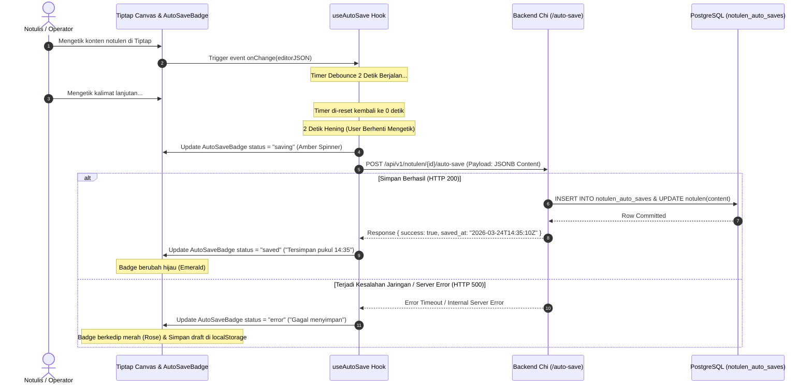
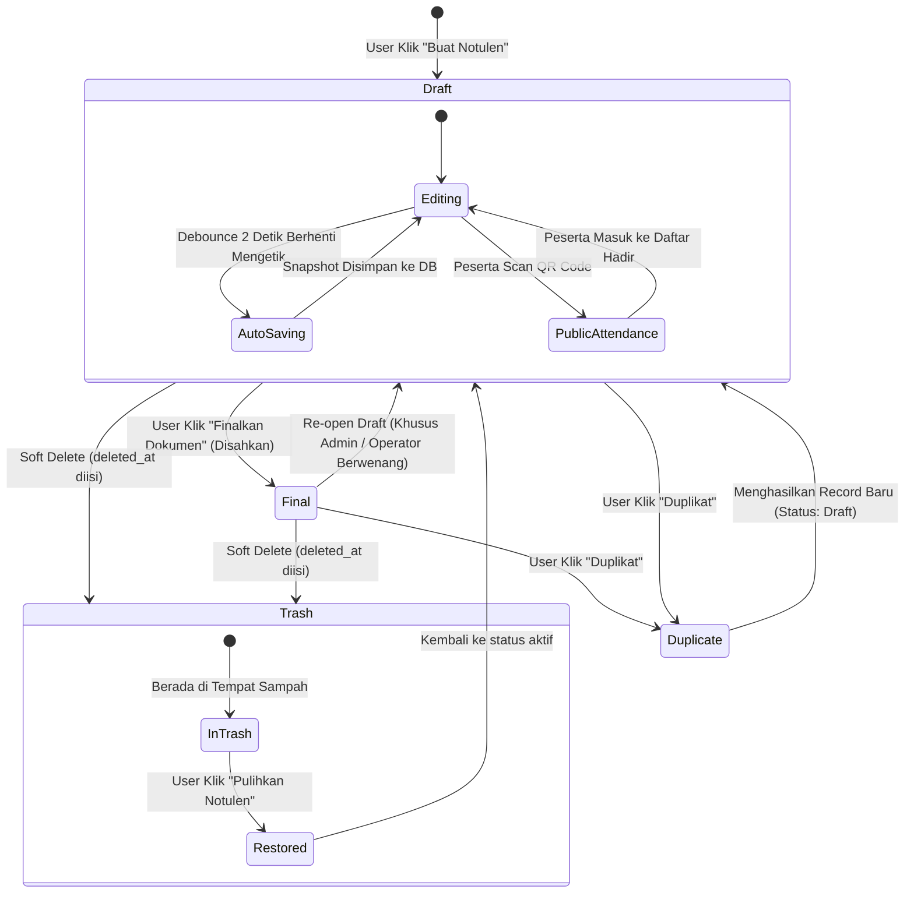

# APP_FLOW.md — Alur Kerja & Spesifikasi Interaksi e-Notulen

## 📐 Sitemap Overview

```mermaid
graph TD
    %% Auth Node
    A["🔐 Login SSO Keycloak<br/>(accounts.purbalinggakab.go.id)"] --> B["📊 Dashboard Utama (/dashboard)"]

    %% Global Command Palette
    B -. "Shortcut [Ctrl + K] / [Cmd + K]" .-> CP["⚡ Command Palette Global Modal"]
    CP -. Navigasi Cepat .-> B
    CP -. Navigasi Cepat .-> C1
    CP -. Navigasi Cepat .-> C2
    CP -. Navigasi Cepat .-> D
    CP -. Navigasi Cepat .-> E

    %% Modul Notulen Rapat
    B --> C["📝 Modul Notulen (/notulen)"]
    C --> C1["Daftar Notulen & Filter Multi-Kriteria"]
    C --> C2["Form Buat Notulen Baru (/notulen/create)"]
    C --> C3["Detail Notulen Resmi (/notulen/[id])"]
    C --> C4["Editor Notulen (/notulen/[id]/edit)"]
    C1 --> C5["Tempat Sampah / Trash View (?trash=true)"]

    %% Aksi Detail Notulen
    C3 --> C3a["📄 Unduh PDF Resmi (Kop Surat + TTD)"]
    C3 --> C3b["📝 Unduh Microsoft Word (.docx)"]
    C3 --> C3c["📋 Duplikasi Notulen (Modal Konfirmasi)"]
    C3 --> C3d["🖨️ Cetak Dokumen Langsung (Print Mode)"]

    %% Fitur Form & Editor
    C4 --> C4a["Tiptap Canvas (Click-to-Focus, A4 Simulation)"]
    C4 --> C4b["Unggah Dokumen PDF Fisik via Backend Proxy"]
    C4 --> C4c["Daftar Hadir Internal (Combobox SKPD)"]
    C4 --> C4d["📱 QR Code Absensi Tamu Mandiri"]
    C4 --> C4e["📷 Galeri Dokumentasi Foto Kegiatan"]
    C4 --> C4f["🖋️ Blok TTD Ganda (Pimpinan & Notulis)"]
    C4 --> C4g["💾 Real-Time AutoSaveBadge (Debounced 2s)"]

    %% Alur Absensi Tamu Publik
    C4d ==> PUB["🌐 Form Absensi Publik (/absensi/[id])"]
    PUB --> PUB_SUBMIT["Peserta Isi: Nama, Instansi, Jabatan"]
    PUB_SUBMIT --> PUB_OK["Kehadiran Tercatat Otomatis di Database"]
    PUB_OK -. Sinkronisasi Masuk .-> C4c

    %% Rekap Laporan
    B --> D["📈 Rekap Laporan Rapat (/reports)"]
    D --> D1["Ringkasan Metrik (Total, Draft, Final, Peserta)"]
    D --> D2["Tabel Aktivitas Kegiatan Rapat & Filter"]
    D --> D3["📥 Unduh Rekap Data Tabular (CSV / Excel)"]
    D --> D4["🖨️ Cetak Rekapitulasi Ber-Kop Dinas"]

    %% Pengaturan Kop Surat
    B --> E["🏢 Pengaturan Kop Surat OPD (/settings/opd)"]
    E --> E1["Form Identitas OPD & Kontak Dinas"]
    E --> E2["🖼️ Unggah Logo via Backend Proxy (/upload-doc)"]
    E --> E3["👁️ Live Interactive Letterhead Preview"]
```



---

## 🗂️ Struktur Rute Navigasi (Next.js 15 App Router)

| Rute URL Frontend | Tipe Hak Akses | Deskripsi & Komponen Utama | Query Parameters / State |
| ----------------- | -------------- | -------------------------- | ------------------------ |
| `/` | Publik (Auto-Redirect) | Pemeriksaan sesi: jika login redirect ke `/dashboard`, jika tidak ke `/login` | - |
| `/login` | Publik | Halaman login resmi Pemkab Purbalingga dengan tombol SSO Keycloak e-Akun | `?callbackUrl=...` |
| `/absensi/[id]` | **Publik (Bebas Akses)** | Formulir absensi mandiri tamu rapat via pemindaian QR Code (mobile-first card) | `id` = UUID Notulen |
| `/dashboard` | Terautentikasi (All) | Ringkasan metrik rapat, `MonthlyTrendChart`, `OpdRankChart`, dan 5 notulen terbaru | - |
| `/notulen` | Terautentikasi (All) | Tabel daftar notulen dengan tab status, filter tanggal, OPD, pencarian, dan paginasi | `?status=`, `?search=`, `?page=`, `?trash=` |
| `/notulen/create` | Terautentikasi (All) | Formulir pembuatan notulen rapat baru (`NotulenForm`) | - |
| `/notulen/[id]` | Terautentikasi (All) | Tampilan detail notulen read-only resmi, tombol ekspor PDF, Word, duplikasi, & cetak | `id` = UUID Notulen |
| `/notulen/[id]/edit` | Terautentikasi (All) | Penyuntingan notulen lengkap: Tiptap canvas, daftar hadir, dokumentasi foto, QR absensi | `id` = UUID Notulen |
| `/reports` | Terautentikasi (Admin/Opr) | Dashboard rekapitulasi pelaporan kegiatan rapat, ekspor CSV, dan layout cetak dinas | `?date_from=`, `?date_to=`, `?opd=`, `?page=` |
| `/settings/opd` | Terautentikasi (Admin/Opr/Off) | Konfigurasi kop surat dinas, unggah logo via backend proxy, dan live preview kop surat | `?opd=` (Khusus Super Admin) |

---

## 🔐 Alur 1: Login & Autentikasi Keycloak OIDC SSO

```
┌─────────────────────────────────────────────────────────────────────────────┐
│                          DIAGRAM ALUR AUTENTIKASI                           │
└─────────────────────────────────────────────────────────────────────────────┘

   Pengguna Mengakses e-Notulen (cth: https://enotulen.purbalinggakab.go.id/)
          │
          ▼
   ┌──────────────┐      Ya      ┌────────────────────────────────────────┐
   │ Token Cookie │─────────────▶│ Izinkan Masuk ke Halaman Dituju        │
   │ Masih Valid? │              └────────────────────────────────────────┘
   └──────┬───────┘
          │ Tidak Ada / Kedaluwarsa
          ▼
   ┌─────────────────────────────────────────┐
   │ Halaman Login (/login)                  │
   │ Menampilkan Identitas Resmi Daerah:     │
   │ "Sistem Informasi Risalah Rapat Digital │
   │  Pemerintah Kabupaten Purbalingga"      │
   └────────────────────┬────────────────────┘
                        │ Klik "Masuk Menggunakan SSO e-Akun"
                        ▼
   ┌─────────────────────────────────────────────────────────┐
   │ Redirect ke Keycloak SSO Purbalingga:                   │
   │ https://accounts.purbalinggakab.go.id/auth/realms/apps  │
   │ /protocol/openid-connect/auth?client_id=e-notulen       │
   │ &response_type=code&scope=openid+profile+email          │
   │ &redirect_uri=https://.../api/auth/callback             │
   └────────────────────┬────────────────────────────────────┘
                        │ Pengguna memasukkan NIP & Password ASN
                        ▼
   ┌──────────────┐     Gagal    ┌────────────────────────────────────────┐
   │ Kredensial   │─────────────▶│ Tampilkan Pesan Error di Layar SSO      │
   │ Valid di SSO?│              └────────────────────────────────────────┘
   └──────┬───────┘
          │ Berhasil
          ▼
   ┌─────────────────────────────────────────────────────────┐
   │ Callback ke Frontend Handler (/api/auth/callback):      │
   │ 1. Exchange Authorization Code ke Token Endpoint SSO    │
   │ 2. Dapatkan ID Token, Access Token, & Refresh Token     │
   │ 3. Simpan Token pada HttpOnly Secure Cookie             │
   └────────────────────┬────────────────────────────────────┘
                        │
                        ▼
   ┌─────────────────────────────────────────────────────────┐
   │ Ekstraksi Role & Konteks User dari Claims JWT:          │
   │ ┌─────────────────────────────────────────────────────┐ │
   │ │ A. SUPER ADMIN (role == 'admin')                    │ │
   │ │    - sub: UUID User                                 │ │
   │ │    - name: "Super Admin BKPPD"                      │ │
   │ │    - Cakupan: Bebas memilih dan melihat semua OPD   │ │
   │ ├─────────────────────────────────────────────────────┤ │
   │ │ B. OPERATOR OPD (role == 'operator')                │ │
   │ │    - sub: UUID User, kode_unit: "T8"                │ │
   │ │    - opd_name: "Dinas Komunikasi dan Informatika"   │ │
   │ │    - Cakupan: Mengelola seluruh notulen di OPD 'T8' │ │
   │ ├─────────────────────────────────────────────────────┤ │
   │ │ C. OFFICER / NOTULIS (role == 'officer')            │ │
   │ │    - sub: UUID User, officer.nip: "1988..."         │ │
   │ │    - officer.unit.id: "T8"                          │ │
   │ │    - Cakupan: Hanya mengelola risalah buatannya     │ │
   │ └─────────────────────────────────────────────────────┘ │
   │ (Dev Mode: Tersedia widget DevRoleSwitcher lokal)       │
   └────────────────────┬────────────────────────────────────┘
                        │
                        ▼
   ┌─────────────────────────────────────────────────────────┐
   │ Redirect Sukses ke /dashboard                           │
   └─────────────────────────────────────────────────────────┘
```

---

## 📊 Alur 2: Dashboard Analitik & Metrik Utama

```
┌──────────────────────────────────────────────────────────────────────────────────────────────────────────┐
│                                          WIREFRAME DASHBOARD                                             │
├──────────────────────────────────────────────────────────────────────────────────────────────────────────┤
│ [Logo] e-Notulen Purbalingga                    [🔍 Cari Ctrl+K]               [🔔] [👤 Budi S. (Operator)]│
├───────────────────┬──────────────────────────────────────────────────────────────────────────────────────┤
│ 📊 Dashboard      │  Selamat datang kembali, Budi Santoso 👋                                             │
│ 📝 Notulen Rapat  │  Dinas Komunikasi dan Informatika Kabupaten Purbalingga                              │
│ 📈 Rekap Laporan  │                                                                                      │
│ 🏢 Setting Kop OPD│  ┌───────────────────────┐  ┌───────────────────────┐  ┌───────────────────────────┐ │
│ ──────────────    │  │ 📑 Total Notulen      │  │ 📅 Bulan Berjalan     │  │ ⚖️ Rasio Status            │ │
│ ⚙️ Pengaturan     │  │        148            │  │         16            │  │ 134 Final  /  14 Draft    │ │
│ 🚪 Keluar         │  └───────────────────────┘  └───────────────────────┘  └───────────────────────────┘ │
│                   │                                                                                      │
│                   │  ┌─────────────────────────────────────────────────────────────────────────────────┐ │
│                   │  │ 📈 Grafik Tren Risalah Rapat (12 Bulan Terakhir) — MonthlyTrendChart            │ │
│                   │  │ 25│                                                                             │ │
│                   │  │ 20│              ■                                                              │ │
│                   │  │ 15│       ■      ■   ■          ■                                               │ │
│                   │  │ 10│   ■   ■  ■   ■   ■   ■      ■   ■                                           │ │
│                   │  │  0└───┴───┴───┴───┴───┴───┴───┴───┴───┴───┴───┴─────────────────────────────── │ │
│                   │  │      Jan Feb Mar Apr Mei Jun Jul Ags Sep Okt Nov Des                            │ │
│                   │  └─────────────────────────────────────────────────────────────────────────────────┘ │
│                   │                                                                                      │
│                   │  ┌─────────────────────────────────────────────────────────────────────────────────┐ │
│                   │  │ 📊 Peringkat Aktivitas Risalah Rapat per OPD — OpdRankChart (Khusus Super Admin)│ │
│                   │  │ Dinkominfo     : ████████████████████████ 48 Notulen                            │ │
│                   │  │ Bappelitbangda : ██████████████████ 36 Notulen                                  │ │
│                   │  │ Dindukcapil    : ██████████████ 28 Notulen                                      │ │
│                   │  │ DKK            : ██████████ 20 Notulen                                          │ │
│                   │  └─────────────────────────────────────────────────────────────────────────────────┘ │
│                   │                                                                                      │
│                   │  ┌──────────────────────────────────────────────────┐  ┌───────────────────────────┐ │
│                   │  │ 🕒 Risalah Rapat Terbaru                         │  │ ⚡ Aksi Cepat             │ │
│                   │  │ • Rapat Evaluasi SPBE Triwulan I [✅ Final]       │  │ [➕ Buat Notulen Baru]   │ │
│                   │  │ • Koordinasi Pengamanan Siber    [📝 Draft]       │  │ [📊 Buka Rekap Laporan]  │ │
│                   │  │ • Sosialisasi e-Office Purbalingga [✅ Final]    │  │ [🏢 Konfigurasi Kop OPD] │ │
│                   │  └──────────────────────────────────────────────────┘  └───────────────────────────┘ │
└───────────────────┴──────────────────────────────────────────────────────────────────────────────────────┘
```

### Matriks Data Dashboard Berdasarkan Hak Akses
| Elemen Dashboard | Super Admin (`admin`) | Operator OPD (`operator`) | Officer (`officer`) |
| ---------------- | --------------------- | ------------------------- | ------------------- |
| **Penyapa Identitas** | "Super Admin Sistem" | Nama OPD bersangkutan | Nama Lengkap & NIP Pegawai |
| **Cakupan Total Notulen** | Seluruh OPD se-Kabupaten | Notulen di OPD sendiri | Hanya notulen yang dibuat sendiri |
| **Cakupan Notulen Bulan Ini**| Seluruh OPD se-Kabupaten | Notulen di OPD sendiri | Hanya notulen yang dibuat sendiri |
| **Grafik Tren Bulanan** | Agregat seluruh kabupaten | Agregat OPD sendiri | Agregat milik sendiri |
| **Grafik OpdRankChart** | **Tampil Lengkap** | Sembunyi otomatis | Sembunyi otomatis |
| **Feed Notulen Terbaru** | Lintas seluruh OPD | Khusus OPD sendiri | Khusus milik sendiri |

---

## 📝 Alur 3: Formulir Notulen Terpadu (`/notulen/create` & `/edit`)

Formulir notulen dirancang lengkap untuk mengakomodasi tata naskah dinas, penugasan pimpinan rapat, penanda tangan terpisah, dan mode input ganda.

```
┌──────────────────────────────────────────────────────────────────────────────────────────────────────────┐
│                                  WIREFRAME FORMULIR NOTULEN LENGKAP                                      │
├──────────────────────────────────────────────────────────────────────────────────────────────────────────┤
│  ← Kembali ke Daftar Notulen                      [💾 Status: Tersimpan pukul 14:35]  [Simpan Draft] [Final]│
├──────────────────────────────────────────────────────────────────────────────────────────────────────────┤
│  BAGIAN 1: METADATA UTAMA RAPAT                                                                          │
│  Judul Rapat *       : [Rapat Koordinasi Penerapan Smart City Purbalingga 2026_________________________]│
│  Hari & Tanggal *    : [📅 24 Maret 2026___________]    Waktu : [🕐 09:00] s.d [🕐 12:30] [x] Selesai    │
│  Tempat Rapat *      : [Ruang Rapat Kepala Dinas, Lt. 2 DINKOMINFO______________________________________]│
│  OPD Penyelenggara * : [Dinas Komunikasi dan Informatika (T8) ▼] (Terkunci jika Operator/Officer)        │
├──────────────────────────────────────────────────────────────────────────────────────────────────────────┤
│  BAGIAN 2: PIMPINAN RAPAT & PEJABAT PENANDA TANGAN DOKUMEN                                               │
│  Pemimpin Rapat:                                                                                         │
│  Nama Pemimpin *     : [Drs. Bambang Wijonarko, M.Si_______] Jabatan: [Kepala Dinas Kominfo____________]│
│  NIP Pemimpin        : [197103151996031002_________________]                                             │
│                                                                                                          │
│  Pejabat Penanda Tangan Dokumen:                                                                         │
│  [x] Pejabat Penanda Tangan Sama dengan Pemimpin Rapat di Atas                                           │
│  (Jika tidak dicentang, input terbuka untuk: Nama Penanda Tangan, Jabatan Penanda Tangan, & NIP)         │
│                                                                                                          │
│  Notulis / Pencatat:                                                                                     │
│  Nama Notulis *      : [Budi Santoso, S.Kom________________] Jabatan: [Pranata Komputer Ahli Muda______]│
│  NIP Notulis         : [198501012010011001_________________]                                             │
├──────────────────────────────────────────────────────────────────────────────────────────────────────────┤
│  BAGIAN 3: PILIHAN TIPE INPUT RISALAH                                                                    │
│  (*) Tulis Langsung (Rich Text Editor Tiptap)       ( ) Unggah Berkas Fisik PDF Hasil Scan               │
│                                                                                                          │
│  ┌─────────────────────────────────────────────────────────────────────────────────────────────────────┐ │
│  │ [Bold] [Italic] [H1] [H2] [Bullet] [Number] [Table] [Undo] [Redo] | [AutoSaveBadge: Tersimpan 14:35]│ │
│  ├─────────────────────────────────────────────────────────────────────────────────────────────────────┤ │
│  │ (Kanvas Kertas Putih A4 — Klik di mana saja untuk mulai mengetik):                                  │ │
│  │ I. Pembukaan & Pengantar Rapat                                                                      │ │
│  │    Rapat dibuka pukul 09.00 WIB oleh Kepala Dinas Kominfo dengan agenda...                          │ │
│  │ II. Pembahasan Masalah & Rekomendasi Aksi                                                           │ │
│  │    ┌───────────────────────────┬───────────────────────────────┬────────────────────────────┐       │ │
│  │    │ Program / Sasaran         │ Kendala Lapangan              │ Rekomendasi Solusi         │       │ │
│  │    ├───────────────────────────┼───────────────────────────────┼────────────────────────────┤       │ │
│  │    │ Integrasi Layanan Publik  │ Format data belum seragam     │ Standardisasi REST API     │       │ │
│  │    └───────────────────────────┴───────────────────────────────┴────────────────────────────┘       │ │
│  │ III. Kesimpulan & Penutup                                                                           │ │
│  └─────────────────────────────────────────────────────────────────────────────────────────────────────┘ │
├──────────────────────────────────────────────────────────────────────────────────────────────────────────┤
│  BAGIAN 4: DAFTAR HADIR PESERTA & QR CODE ABSENSI MANDIRI                                                │
│  [➕ Tambah Peserta Manual]   [📱 Tampilkan QR Code Absensi Tamu]   Total Terdaftar: 18 Peserta            │
│  ┌───┬──────────────────────────────┬──────────────────────────────┬────────────────────────┬──────────┐ │
│  │No │ Nama Lengkap Peserta         │ Instansi / OPD Asal          │ Jabatan Peserta        │ Aksi     │ │
│  ├───┼──────────────────────────────┼──────────────────────────────┼────────────────────────┼──────────┤ │
│  │ 1 │ Ir. Tri Gunawan, M.T.        │ Bappelitbangda Purbalingga   │ Kabid Litbang          │ [✏️] [🗑️] │ │
│  │ 2 │ Siti Rahayu, S.IP.           │ Dindukcapil Purbalingga      │ Analis Kebijakan       │ [✏️] [🗑️] │ │
│  └───┴──────────────────────────────┴──────────────────────────────┴────────────────────────┴──────────┘ │
├──────────────────────────────────────────────────────────────────────────────────────────────────────────┤
│  BAGIAN 5: DOKUMENTASI FOTO KEGIATAN RAPAT                                                               │
│  [Unggah Foto Kegiatan] (Maksimal 20 Foto, JPG/PNG, Kompresi Otomatis Backend Proxy)                    │
│  ┌────────────────────┐ ┌────────────────────┐ ┌────────────────────┐ ┌───────────────────────────────┐ │
│  │ [Preview Foto 1]   │ │ [Preview Foto 2]   │ │ [Preview Foto 3]   │ │ ➕ Unggah Foto Lainnya        │ │
│  │ [🗑️ Hapus]        │ │ [🗑️ Hapus]        │ │ [🗑️ Hapus]        │ │ (Drag & drop foto di sini)  │ │
│  └────────────────────┘ └────────────────────┘ └────────────────────┘ └───────────────────────────────┘ │
├──────────────────────────────────────────────────────────────────────────────────────────────────────────┤
│  BAGIAN 6: PRATINJAU BLOK TANDA TANGAN DOKUMEN                                                           │
│                  Pimpinan Rapat,                                  Purbalingga, 24 Maret 2026             │
│            Kepala Dinas Komunikasi dan                                      Notulis,                     │
│                    Informatika                                                                           │
│                                                                                                          │
│                  ( Tanda Tangan )                                       ( Tanda Tangan )                 │
│                                                                                                          │
│           Drs. Bambang Wijonarko, M.Si                             Budi Santoso, S.Kom                   │
│             NIP. 197103151996031002                              NIP. 198501012010011001                 │
└──────────────────────────────────────────────────────────────────────────────────────────────────────────┘
```

---

## 📱 Alur 4: Form Absensi Tamu Mandiri & QR Code (`/absensi/[id]`)

Fitur absensi mandiri publik memungkinkan ratusan peserta rapat mengisi daftar hadir secara paralel tanpa antre tanda tangan basah di meja registrasi.

```
┌─────────────────────────────────────────────────────────────────────────────┐
│                    ALUR SINKRONISASI KEHADIRAN PUBLIK                       │
└─────────────────────────────────────────────────────────────────────────────┘

   Panitia Membuka Modal "QR Code Absensi" di NotulenForm atau Detail View
                                │
                                ▼
        ┌──────────────────────────────────────────────────┐
        │ [QR CODE BESAR]                                  │
        │ https://enotulen.purbalinggakab.go.id/absensi/   │
        │ 7f8a9b1c-2d3e-4f5a-6b7c-8d9e0f1a2b3c             │
        │ [Salin URL Tautan]   [Unduh Gambar QR Code]      │
        └──────────────────────────────────────────────────┘
                                │
                                ▼ Peserta memindai via kamera ponsel pintar
   Browser Peserta Membuka Halaman Publik (/absensi/[id]):
   ┌─────────────────────────────────────────────────────────────────────────┐
   │ 🏛️ PEMERINTAH KABUPATEN PURBALINGGA                                      │
   │ FORMULIR KEHADIRAN RAPAT DINAS                                          │
   │                                                                         │
   │ 📌 Rapat Koordinasi Penerapan Smart City Purbalingga                    │
   │ 📅 Selasa, 24 Maret 2026  |  🕐 09:00 WIB                               │
   │ 📍 Ruang Rapat Kadis Dinkominfo Lt. 2                                   │
   │ 🏢 Penyelenggara: Dinas Komunikasi dan Informatika                      │
   │                                                                         │
   │ Nama Lengkap & Gelar * : [Dr. Hendro Prasetyo, M.Eng_________________]  │
   │ Asal Instansi / OPD *  : [Badan Kepegawaian Pendidikan dan Pelatihan ▼]  │
   │                          (Pilih dari SKPD atau ketik instansi luar)     │
   │ Jabatan Peserta        : [Kepala Bidang Pembinaan ASN_________________] │
   │                                                                         │
   │                       [ 📩 Kirim Bukti Kehadiran ]                      │
   └────────────────────────────────────┬────────────────────────────────────┘
                                        │
                                        │ POST /api/v1/public/absensi/{id}
                                        ▼
   ┌─────────────────────────────────────────────────────────────────────────┐
   │ Respons Sukses di Layar Ponsel Peserta:                                 │
   │ ✅ "Kehadiran Anda Berhasil Dicatat!"                                   │
   │ Nama: Dr. Hendro Prasetyo, M.Eng (BKPSDM) - Terverifikasi pukul 09:12   │
   └────────────────────────────────────┬────────────────────────────────────┘
                                        │
                                        ▼
   Database Menyimpan Record ke Tabel `notulen_attendees`.
   Panitia Rapat Langsung Melihat Peserta Muncul di AttendeeTable Secara Realtime!
```

---

## 🔄 Alur 5: Debounced Auto-Save & Badge Real-Time

Mekanisme penyimpanan otomatis mencegah hilangnya hasil pengetikan notulen akibat listrik padam, gangguan browser, atau koneksi terputus.



---

## 📥 Alur 6: Detail Dokumen & Dual Ekspor (PDF Resmi & Native Word)

Halaman detail (`/notulen/[id]`) menyajikan dokumen dalam format formal siap cetak dan menyediakan opsi ekspor dokumen resmi:

```
┌─────────────────────────────────────────────────────────────────────────────┐
│                       ALUR EKSPOR DOKUMEN RESMI                             │
└─────────────────────────────────────────────────────────────────────────────┘

   Pengguna Menekan Tombol Aksi di Halaman Detail Notulen:
   ├── 📄 PILIHAN 1: UNDUH PDF RESMI
   │     1. Frontend memicu GET /api/v1/notulen/{id}/download
   │     2. Backend mengaktifkan pkg/pdf (gofpdf native engine):
   │        - Fetch kop surat OPD dari tabel opd_settings
   │        - Ambil logo dinas via Smart Storage Proxy internal
   │        - Kompilasi layout A4: Kop -> Garis Ganda -> Judul "NOTULEN RAPAT"
   │          -> Metadata -> Isi Risalah -> Tabel Peserta -> Blok TTD Ganda
   │          -> Halaman Lampiran Galeri Foto
   │     3. Stream file application/pdf ke browser dengan nama:
   │        "Notulen_Rapat_[ID]_[Tanggal].pdf"
   │
   ├── 📝 PILIHAN 2: UNDUH MICROSOFT WORD (.DOCX) MURNI
   │     1. Frontend memicu GET /api/v1/notulen/{id}/word
   │     2. Backend mengaktifkan pkg/word (WordGenerator native engine):
   │        - Merakit Open Packaging Conventions (OPC) ECMA-376 file ZIP
   │        - Menulis [Content_Types].xml, styles.xml, document.xml
   │        - Menyusun kop surat dinas, tabel peserta bergaris formal,
   │          dan tabel 2 kolom blok tanda tangan pejabat
   │     3. Stream file application/vnd.openxmlformats-officedocument...
   │        "Notulen_Rapat_[ID]_[Tanggal].docx"
   │        (Dapat langsung dibuka & disunting di MS Word / WPS Office tanpa cacat)
   │
   ├── 📋 PILIHAN 3: DUPLIKASI NOTULEN (MODAL KONFIRMASI)
   │     1. User menekan tombol "Duplikat Notulen"
   │     2. Muncul dialog modal: "Buat salinan risalah rapat ini sebagai draf baru?"
   │     3. Konfirmasi "Ya, Duplikat" -> POST /api/v1/notulen/{id}/duplicate
   │     4. Backend mengkloning judul, agenda, peserta, dan konten Tiptap
   │     5. Router otomatis mengarahkan ke /notulen/[new_id]/edit
   │
   └── 🖨️ PILIHAN 4: CETAK LANGSUNG (PRINT VIEW)
         1. User menekan tombol "Cetak" atau shortcut browser Ctrl + P
         2. CSS `@media print` menyembunyikan sidebar navigasi, topbar, dan tombol aksi
         3. Lembar kertas A4 tercetak presisi sesuai tata naskah dinas
```

---

## ⚡ Alur 7: Global Command Palette (`Ctrl + K`)

Navigasi keyboard-first berkecepatan tinggi yang dapat dipanggil dari halaman mana pun:

```
┌─────────────────────────────────────────────────────────────────────────────────┐
│                     WIREFRAME GLOBAL COMMAND PALETTE                            │
├─────────────────────────────────────────────────────────────────────────────────┤
│  ┌───────────────────────────────────────────────────────────────────────────┐  │
│  │ 🔍 Ketik perintah atau nama halaman... (Tekan Esc untuk keluar)           │  │
│  ├───────────────────────────────────────────────────────────────────────────┤  │
│  │ NAVIGASI UTAMA                                                            │  │
│  │  📊 Dashboard                 Ringkasan statistik & aktivitas terbaru     │  │
│  │  📑 Daftar Notulen             Lihat semua risalah rapat yang tersimpan   │  │
│  │  ➕ Buat Notulen Baru          Mulai pencatatan risalah rapat baru        │  │
│  │                                                                           │  │
│  │ PELAPORAN & REKAPITULASI                                                  │  │
│  │  📈 Rekap Laporan Bulanan     Statistik kegiatan rapat & ekspor CSV       │  │
│  │  🏛️ Peringkat Rapat OPD       Visualisasi keaktifan satuan kerja dinas    │  │
│  │                                                                           │  │
│  │ PENGATURAN                                                                │  │
│  │  🏢 Konfigurasi Kop Surat OPD Kelola logo, alamat kantor, & preview kop   │  │
│  │  👤 Profil Saya               Informasi NIP, jabatan, & sesi akun ASN     │  │
│  ├───────────────────────────────────────────────────────────────────────────┤  │
│  │ [↑/↓] Pilih Item    [Enter] Jalankan    [Esc] Batal                       │  │
│  └───────────────────────────────────────────────────────────────────────────┘  │
└─────────────────────────────────────────────────────────────────────────────────┘
```

---

## 📈 Alur 8: Rekap Laporan Rapat & Ekspor CSV (`/reports`)

```
┌──────────────────────────────────────────────────────────────────────────────────────────────────────────┐
│                                  WIREFRAME REKAP LAPORAN KEGIATAN                                        │
├──────────────────────────────────────────────────────────────────────────────────────────────────────────┤
│  Laporan & Rekapitulasi Risalah Rapat                       [📥 Ekspor CSV/Excel]  [🖨️ Cetak Laporan]    │
├──────────────────────────────────────────────────────────────────────────────────────────────────────────┤
│  FILTER REKAP:                                                                                           │
│  Tanggal Mulai: [📅 01/01/2026]  Tanggal Akhir: [📅 31/03/2026]  OPD: [Semua OPD ▼]  Status: [Semua ▼]   │
├──────────────────────────────────────────────────────────────────────────────────────────────────────────┤
│  RINGKASAN PERIODE INI:                                                                                  │
│  ┌───────────────────────┐  ┌───────────────────────┐  ┌───────────────────────────┐  ┌────────────────┐ │
│  │ 📑 Total Risalah      │  │ ✅ Rapat Selesai/Final│  │ 📝 Masih Status Draft     │  │ 👥 Total Tamu  │ │
│  │         48            │  │         42            │  │           6               │  │      612       │ │
│  └───────────────────────┘  └───────────────────────┘  └───────────────────────────┘  └────────────────┘ │
├──────────────────────────────────────────────────────────────────────────────────────────────────────────┤
│  TABEL AKTIVITAS KEGIATAN RAPAT:                                                                         │
│  ┌────┬─────────────────────────────┬────────────┬────────────────────────┬─────────────┬──────────────┐ │
│  │No  │ Judul Kegiatan Rapat        │ Tanggal    │ OPD Penyelenggara      │ Jml Hadir   │ Status       │ │
│  ├────┼─────────────────────────────┼────────────┼────────────────────────┼─────────────┼──────────────┤ │
│  │ 1  │ Koordinasi Smart City       │ 24/03/2026 │ Dinkominfo Purbalingga │ 18 Peserta  │ [✅ Final]   │ │
│  │ 2  │ Evaluasi SPM Triwulan I     │ 20/03/2026 │ Bappelitbangda         │ 24 Peserta  │ [✅ Final]   │ │
│  │ 3  │ Verifikasi Data Bansos      │ 18/03/2026 │ Dinsosdalduk           │ 15 Peserta  │ [📝 Draft]   │ │
│  └────┴─────────────────────────────┴────────────┴────────────────────────┴─────────────┴──────────────┘ │
│  Halaman: [< Prev]  1  2  3  4  5  [Next >]                                                              │
└──────────────────────────────────────────────────────────────────────────────────────────────────────────┘
```

---

## 🏢 Alur 9: Pengaturan Kop Surat OPD & Live Preview (`/settings/opd`)

```
┌──────────────────────────────────────────────────────────────────────────────────────────────────────────┐
│                                 WIREFRAME PENGATURAN KOP SURAT DINAS                                     │
├──────────────────────────────────────────────────────────────────────────────────────────────────────────┤
│  Kustomisasi Identitas & Kop Surat Dinas                                          [💾 Simpan Pengaturan] │
├─────────────────────────────────────────────┬────────────────────────────────────────────────────────────┤
│  FORMULIR KONFIGURASI                       │  👁️ LIVE INTERACTIVE PREVIEW (Wujud Asli di Dokumen)     │
│                                             │                                                            │
│  Pilih OPD (Khusus Super Admin):            │  ┌──────────────────────────────────────────────────────┐  │
│  [Dinas Komunikasi dan Informatika (T8) ▼]  │  │ [Logo]  PEMERINTAH KABUPATEN PURBALINGGA             │  │
│                                             │  │         DINAS KOMUNIKASI DAN INFORMATIKA             │  │
│  Nama Pemerintah Daerah:                    │  │         Jl. Letkol Isdiman No. 17A, Purbalingga      │  │
│  [PEMERINTAH KABUPATEN PURBALINGGA________] │  │         Telp: (0281) 891012, Fax: (0281) 891013      │  │
│                                             │  │         Email: dinkominfo@purbalinggakab.go.id       │  │
│  Nama Organisasi Perangkat Daerah (OPD):    │  │ ════════════════════════════════════════════════════ │  │
│  [DINAS KOMUNIKASI DAN INFORMATIKA________] │  │ (Garis ganda pembatas kop surat resmi kedinasan)     │  │
│                                             │  │                                                      │  │
│  Alamat Kantor Dinas:                       │  │                    NOTULEN RAPAT                     │  │
│  [Jl. Letkol Isdiman No. 17A, Purbalingga_] │  │                                                      │  │
│                                             │  │ Hari / Tanggal : Selasa, 24 Maret 2026               │  │
│  Nomor Telepon & Fax:                       │  │ Waktu          : 09:00 WIB s.d Selesai               │  │
│  Telp: [(0281) 891012] Fax: [(0281) 891013]│  │ Tempat         : Ruang Rapat Kadis Lt. 2             │  │
│                                             │  └──────────────────────────────────────────────────────┘  │
│  Alamat Surel (Email) Resmi:                │                                                            │
│  [dinkominfo@purbalinggakab.go.id_________] │  Catatan: Pratinjau ini akan disematkan otomatis pada      │
│                                             │  seluruh berkas PDF dan Word yang digenerate oleh sistem.  │
│  Unggah Logo Instansi (PNG/JPG maks 2MB):   │                                                            │
│  [📁 Unggah Logo via Backend Proxy________] │                                                            │
└─────────────────────────────────────────────┴────────────────────────────────────────────────────────────┘
```

---

## 🛡️ Alur 10: Penelusuran & Verifikasi Keabsahan Dokumen Fisik via QR Code (`/verifikasi/[id]`)

Fitur verifikasi keabsahan publik menjamin integritas hukum risalah rapat dinas hasil cetakan fisik. Saat dokumen disahkan menjadi status `final`, sistem secara otomatis menyematkan segel kode QR verifikasi dinamis pada blok tanda tangan (`SignatureSection.tsx`) dan cetakan PDF resmi. Siapa pun dapat memindai segel QR tersebut menggunakan kamera ponsel pintar untuk memeriksa validitas naskah langsung ke pangkalan data arsip resmi Pemkab Purbalingga tanpa perlu login ke sistem.

```
┌─────────────────────────────────────────────────────────────────────────────┐
│                 ALUR PENELUSURAN DAN PEMBUKTIAN KEABSAHAN                   │
└─────────────────────────────────────────────────────────────────────────────┘

    Notulis / Operator Memfinalisasi Risalah Rapat (Status: draft -> final)
                                 │
                                 ▼
    Sistem Mengunci Editor Tiptap (Read-Only) & Menerbitkan Segel Kode QR:
    ┌──────────────────────────────────────────────────┐
    │ [QR CODE VERIFIKASI RESMI]                       │
    │ https://enotulen.purbalinggakab.go.id/           │
    │ verifikasi/7f8a9b1c-2d3e-4f5a-6b7c-8d9e0f1a2b3c  │
    └──────────────────────────────────────────────────┘
                                 │
                                 ▼ Dicetak ke Kertas Fisik (PDF Resmi A4)
    Naskah Fisik Tersebar ke Pimpinan / Aparatur / Pihak Berkepentingan
                                 │
                                 ▼ Pemeriksa memindai segel QR via kamera ponsel
    Next.js Middleware Meloloskan Rute Publik (Bypass SSO Keycloak):
    GET /verifikasi/[id] -> API: GET /api/v1/public/verifikasi/[id]
```

```
┌──────────────────────────────────────────────────────────────────────────────────────────────────────────┐
│                          WIREFRAME HALAMAN PUBLIK VERIFIKASI DOKUMEN (/verifikasi/[id])                   │
├──────────────────────────────────────────────────────────────────────────────────────────────────────────┤
│  [Logo Pemkab]  PEMERINTAH KABUPATEN PURBALINGGA                                                         │
│                 Portal Resmi Verifikasi Risalah Rapat Digital (e-Notulen)                                │
├──────────────────────────────────────────────────────────────────────────────────────────────────────────┤
│                                                                                                          │
│  ┌────────────────────────────────────────────────────────────────────────────────────────────────────┐  │
│  │  🛡️ STATUS KEABSAHAN DOKUMEN:                                                                       │  │
│  │                                                                                                    │  │
│  │  [ ✅ DOKUMEN RESMI & TERVERIFIKASI ]   (Warna Latar: Emerald / Hijau Kedinasan)                   │  │
│  │  "Risalah rapat ini sah terdaftar pada pangkalan data arsip resmi Pemerintah Kabupaten Purbalingga" │  │
│  └────────────────────────────────────────────────────────────────────────────────────────────────────┘  │
│                                                                                                          │
│  ┌────────────────────────────────────────────────────────────────────────────────────────────────────┐  │
│  │  RINCIAN INFORMASI RISALAH RAPAT DINAS                                                             │  │
│  │  ────────────────────────────────────────────────────────────────────────────────────────────────  │  │
│  │  Judul Rapat        : Rapat Koordinasi Penerapan Smart City Purbalingga 2026                       │  │
│  │  Tanggal Pelaksanaan: Selasa, 24 Maret 2026                                                        │  │
│  │  Waktu Acara        : 09:00 s.d 12:30 WIB                                                          │  │
│  │  Tempat / Lokasi    : Ruang Rapat Kadis Lt. 2, DINKOMINFO Purbalingga                              │  │
│  │  OPD Penyelenggara  : Dinas Komunikasi dan Informatika Kabupaten Purbalingga                       │  │
│  │  ID Naskah Arsip    : 7f8a9b1c-2d3e-4f5a-6b7c-8d9e0f1a2b3c                                         │  │
│  └────────────────────────────────────────────────────────────────────────────────────────────────────┘  │
│                                                                                                          │
│  ┌──────────────────────────────────────────────┐  ┌─────────────────────────────────────────────────┐  │
│  │  PEJABAT PENANDATANGAN NASKAH:               │  │  NOTULIS / PENCATAT RESMI:                      │  │
│  │  Nama   : Drs. Bambang Wijonarko, M.Si       │  │  Nama   : Budi Santoso, S.Kom                   │  │
│  │  NIP    : 19710315 199603 1 002              │  │  NIP    : 19850101 201001 1 001                 │  │
│  │  Jabatan: Kepala Dinas Kominfo Purbalingga   │  │  Jabatan: Pranata Komputer Ahli Muda            │  │
│  └──────────────────────────────────────────────┘  └─────────────────────────────────────────────────┘  │
│                                                                                                          │
│  ┌────────────────────────────────────────────────────────────────────────────────────────────────────┐  │
│  │  Waktu Pengesahan Resmi : 24 Maret 2026 pukul 14:35 WIB (Terkunci Sistem)                           │  │
│  │                                                                                                    │  │
│  │  [ 📥 Unduh Salinan Berkas Digital Resmi (PDF A4) ]                                                 │  │
│  └────────────────────────────────────────────────────────────────────────────────────────────────────┘  │
│                                                                                                          │
│  Catatan Hukum: Dokumen ini telah diverifikasi melalui sistem segel digital kriptografi e-Notulen        │
│  berdasarkan Peraturan Bupati Purbalingga tentang Tata Naskah Dinas Elektronik.                          │
└──────────────────────────────────────────────────────────────────────────────────────────────────────────┘
```

---

## 🔄 State Machine: Siklus Hidup Dokumen Notulen



---

## ⚠️ Penanganan Error & Ketahanan Sistem (Frontend & Backend)

| Skenario Error | Respon Backend / Sistem | Perilaku Antarmuka (UX) |
| -------------- | ----------------------- | ----------------------- |
| **Token Expired (401)** | Backend menolak request dengan header `WWW-Authenticate` | Next.js Axios interceptor mencoba refresh token di background; jika gagal, redirect mulus ke login |
| **Akses Terlarang (403)** | Backend merespon `{ success: false, message: "Forbidden role" }` | Menampilkan Toast Error merah dan tombol "Kembali ke Beranda" |
| **Storage MinIO 404 / Missing Key** | `Smart Storage Proxy` mengaktifkan fuzzy matching suffix dan multi-bucket fallback | Jika benar-benar musnah, fallback ke logo default Pemkab Purbalingga (`LOGO.jpg`) |
| **Offline Saat Mengetik** | Permintaan auto-save gagal timeout | `AutoSaveBadge` berubah merah berkedip ("Gagal menyimpan") & konten dicadangkan sementara di `localStorage` |
| **Validasi Form Kosong** | Frontend form validator memblokir submit | Highlight merah pada field wajib (Judul, Tanggal, Tempat, Pemimpin, Notulis) |
